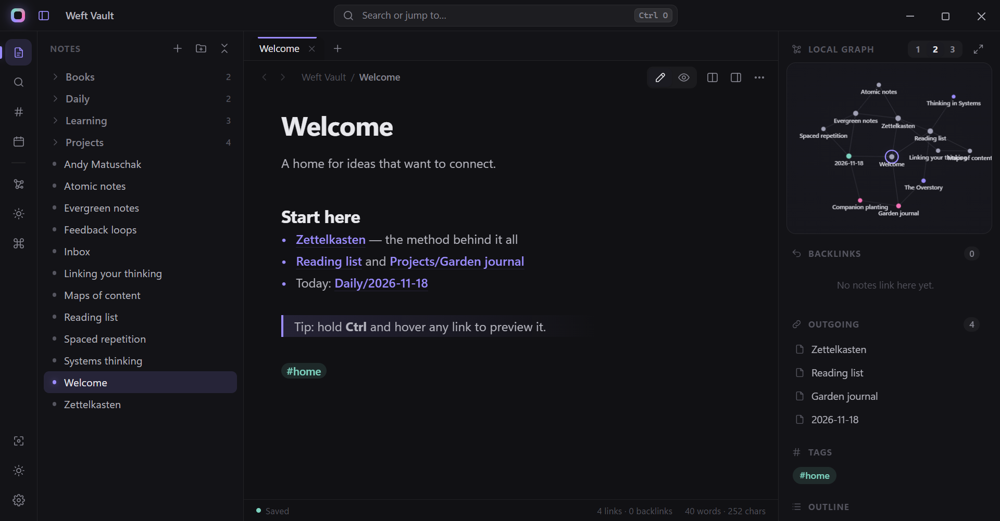
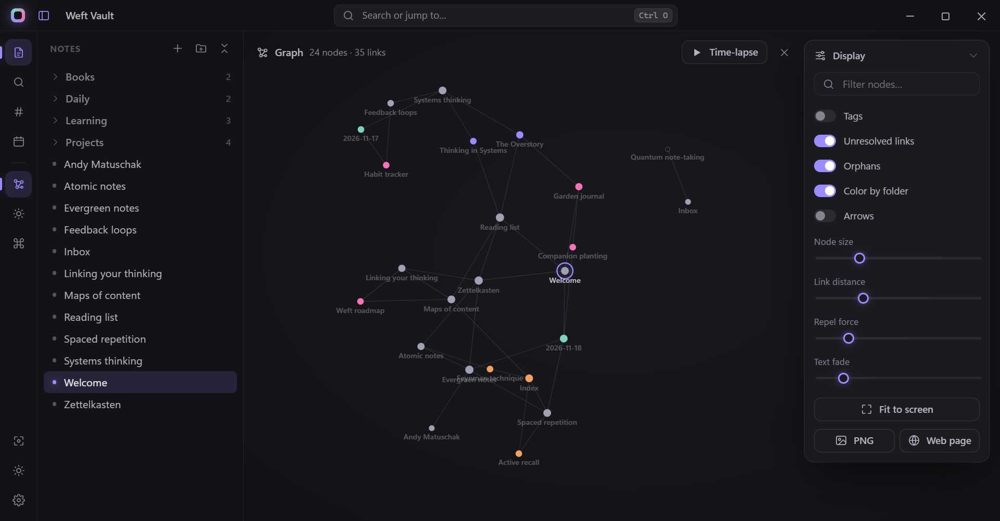

<div align="center">


# Weft

**A quiet place for connected thinking.**

Weft is a sleek, local-first notes app. Write in Markdown with a live preview, link ideas with `[[wiki links]]`,
and watch them weave together in a living graph — all stored as plain files on your own computer.

[**Download for Windows, macOS or Linux →**](https://github.com/OrangeBubly/weft/releases/latest)

</div>





## Features

**Writing**
- **Live preview editor** — headings, bold, lists, checkboxes, quotes, code and images render as you type; the Markdown appears only on the line you're editing
- **`[[Wiki links]]`** with autocomplete — link to a note that doesn't exist yet and Weft creates it on click
- **Backlinks** with context, outgoing links, tags and an outline for every note
- **Hover previews** — hold <kbd>Ctrl</kbd> and hover any link to peek at the note
- **Tabs and split view**, back / forward history per tab
- **Daily notes** (<kbd>Ctrl</kbd> <kbd>Shift</kbd> <kbd>D</kbd>) and a **calendar** with an activity heatmap and writing streak
- **Focus mode** and typewriter scrolling for distraction-free writing

**Seeing connections**
- **Graph view** — every note as a node, every link as a line; hover to light up neighbours, drag, zoom, filter, colour by folder
- **Graph time-lapse** — press play and watch your vault grow in the order you wrote it
- **Local graph** — the current note's neighbourhood, always beside the editor
- **Export the graph** as a high-resolution PNG or an interactive web page (titles only, never note contents)

**Feel**
- Five themes — Midnight, Forest, Ember, Paper and Mist — plus any accent colour you like
- **Command palette** (<kbd>Ctrl</kbd> <kbd>P</kbd>) and quick switcher (<kbd>Ctrl</kbd> <kbd>O</kbd>)
- Renaming a note updates every link that points to it

**Yours**
- Notes are plain `.md` files in a folder you choose — open them in any editor, sync them however you like
- Works fully offline. Nothing is uploaded anywhere.

## Install

Grab the latest build from the [Releases page](https://github.com/OrangeBubly/weft/releases/latest):

| Platform | File |
| --- | --- |
| Windows | `Weft-Setup-x.y.z.exe` |
| macOS (Apple Silicon) | `Weft-x.y.z-mac-arm64.dmg` |
| macOS (Intel) | `Weft-x.y.z-mac-x64.dmg` |
| Linux | `Weft-x.y.z-linux-….AppImage` |

Weft isn't code-signed yet (signing certificates cost money), so your OS will be cautious the first time:

- **Windows:** if SmartScreen says *"Windows protected your PC"*, click **More info → Run anyway**.
- **macOS:** after dragging Weft to Applications, run `xattr -cr /Applications/Weft.app` in Terminal once, then open it normally.
- **Linux:** make the AppImage executable (`chmod +x Weft-*.AppImage`) and run it.

## Keyboard shortcuts

| Action | Shortcut |
| --- | --- |
| Command palette | <kbd>Ctrl</kbd> <kbd>P</kbd> |
| Quick switcher | <kbd>Ctrl</kbd> <kbd>O</kbd> |
| New note | <kbd>Ctrl</kbd> <kbd>N</kbd> |
| Today's daily note | <kbd>Ctrl</kbd> <kbd>Shift</kbd> <kbd>D</kbd> |
| New tab / close tab | <kbd>Ctrl</kbd> <kbd>T</kbd> / <kbd>Ctrl</kbd> <kbd>W</kbd> |
| Toggle reading view | <kbd>Ctrl</kbd> <kbd>E</kbd> |
| Graph view | <kbd>Ctrl</kbd> <kbd>G</kbd> |
| Search all notes | <kbd>Ctrl</kbd> <kbd>Shift</kbd> <kbd>F</kbd> |
| Focus mode | <kbd>Ctrl</kbd> <kbd>Shift</kbd> <kbd>Enter</kbd> |
| Switch light / dark | <kbd>Ctrl</kbd> <kbd>Shift</kbd> <kbd>L</kbd> |
| Settings | <kbd>Ctrl</kbd> <kbd>,</kbd> |

On macOS, use <kbd>Cmd</kbd> instead of <kbd>Ctrl</kbd>.

## Build from source

Requires [Node.js](https://nodejs.org) 20 or newer.

```bash
git clone https://github.com/OrangeBubly/weft.git
cd weft
npm install
npm start          # run the app
npm run dist       # build an installer for your OS into dist/
```

The app is plain JavaScript on [Electron](https://www.electronjs.org/); the editor is [CodeMirror 6](https://codemirror.net/).

| Path | What it is |
| --- | --- |
| `main.js` | Electron main process: vault files, window, exports |
| `preload.js` | The small, safe bridge between the window and the file system |
| `src/editor.js` | Live-preview editor (bundled to `renderer/editor.bundle.js`) |
| `renderer/app.js` | The app UI: panes, tabs, sidebar, search, calendar, settings |
| `renderer/graph.js` | Force-directed graph renderer (no dependencies) |
| `renderer/styles.css` | Themes and styling |

Releases are built automatically for all three platforms by GitHub Actions whenever a release is published.

## License

[MIT](LICENSE)
